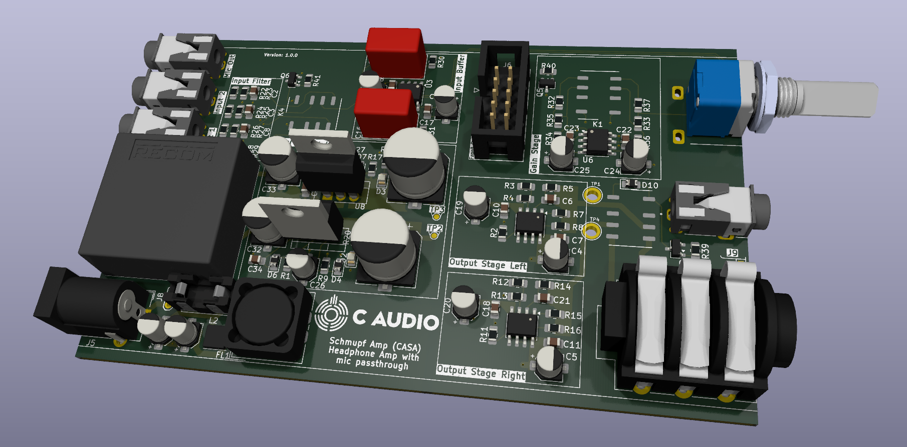

# Schmupf-Amp (CASA)
Small Stereo Headphone Amp with microphone passthrough fitting into a nice case.

Simple leader follower parallel opamp topology.

# Signal Path 
Input -> Filter -> Input switch -> Input Buffer -> Volume control -> Voltage Gain Stage -> Current Gain Stage -> Output

Bipolar linear post regulated power supply derived from 12V with a REC10K +-12V Module. Voltage for the opamps is +-9V.d
